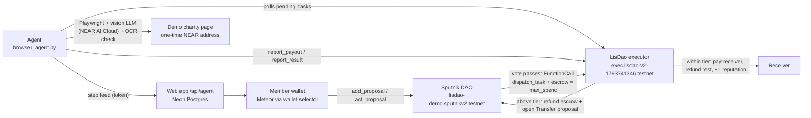

<h1 align="center">LisDao</h1>
<p align="center"><strong>Your community votes. An AI agent does the job in a real browser. A NEAR contract pays, within limits the DAO sets.</strong></p>
<p align="center">
  <a href="https://lisdao.vercel.app"><strong>Live app ↗</strong></a> · Demo video (demo video link coming) · <a href="#proof">On-chain proof</a> · <a href="#quickstart">Run it</a> · <a href="#limits">What it does not do yet</a>
</p>
<p align="center"><sub>NEAR TESTNET · SPUTNIK DAO v2 · RUST (near-sdk 5) · NEXT.JS 15 · PLAYWRIGHT · NEAR AI CLOUD · Built at NEAR HACKATHON</sub></p>

> **Testnet only.** No mainnet deployment and no real money. The "Water Project" charity is a demo page in this repo.

## What it is
LisDao is an AI executor for **Sputnik DAO v2**. The votes and the treasury stay in Sputnik. LisDao adds one thing: a proposal written in plain words ("Donate 0.1 NEAR to the water project") that, once the council passes it, is carried out by an AI agent in a real browser and paid by a contract, never by the agent. The live demo agent runs on **NEAR AI Cloud** (`x-ai/grok-4.7`); proposal #9 was completed end to end with it. A run with the cheaper `z-ai/glm-5.3-flash` (proposal #8) failed safely: it misread one character of the deposit address and the exact-match check refused to pay.

## How it works

1. A council member creates a Sputnik `FunctionCall` proposal to `dispatch_task` (0.01 NEAR bond, signed in their wallet).
2. The council votes. When it passes, Sputnik calls the executor and attaches `max_spend` as escrow.
3. The agent picks up the task, drives a browser, reads the payout address, and checks it against page text and OCR.
4. The agent calls `report_payout`. The **contract** decides: pay now, or escalate to a new DAO vote.

## Payout tiers
| Rule | Enforced in |
|---|---|
| Proposer's auto-approve limit = 0.2 NEAR + 0.1 NEAR per proposer reputation point, max 1 NEAR (not an agent fee — the agent receives nothing) | `executor/src/lib.rs` `auto_cap_of` |
| Amount must be > 0, ≤ `max_spend`, ≤ escrow | `report_payout` (`"over spending cap"`) |
| Within tier → pay receiver, return the rest to the DAO, proposer +1 reputation | `report_payout` |
| Above tier → escrow back to the DAO, executor opens a Sputnik `Transfer` proposal | `report_payout` |
| Failure → status `Failed`, escrow back to the DAO | `report_result` |

<a id="proof"></a>
## On-chain proof (NEAR testnet)
| What | Transaction |
|---|---|
| DAO | [lisdao-demo.sputnikv2.testnet](https://testnet.nearblocks.io/address/lisdao-demo.sputnikv2.testnet) |
| Executor | [exec.lisdao-v2-1793741346.testnet](https://testnet.nearblocks.io/address/exec.lisdao-v2-1793741346.testnet) |
| Proposal #5 created | [2RFPFNEW…](https://testnet.nearblocks.io/txns/2RFPFNEWBn9J7Lya8tLfdxGTWcG9SjYbMNwyiBBHtWJF) |
| Proposal #5 approved by council (VoteApprove → dispatches task 4; payout tx not recorded) | [C4gPFrU9…](https://testnet.nearblocks.io/txns/C4gPFrU9xjECcydmC61TY4vN99Y6dqKxdKN9omMniPL6) |
| Proposal #6 created | [2h7V8Jk5…](https://testnet.nearblocks.io/txns/2h7V8Jk51PhX9Br7Z14iM6zekUEAmE5opCrE3M8HZLeK) |
| Proposal #6 payout: agent calls `report_payout`, contract sends 0.1 NEAR to a one-time demo-charity address | [ogdnYy2S…](https://testnet.nearblocks.io/txns/ogdnYy2Sv8c1zq9NYXiiEuJWj6d3cmuoQvtZxaBnTuF) |
| Proposal #7 payout: agent calls `report_payout`, contract sends 0.1 NEAR to a one-time demo-charity address | [78pmYEL4…](https://testnet.nearblocks.io/txns/78pmYEL4PWZVuVnBNhkZsQAuAUKHZbGV1eK4qgUHJ5yu) |
| Proposal #9 created (live agent on NEAR AI Cloud, `x-ai/grok-4.7`) | [BLWit74i…](https://testnet.nearblocks.io/txns/BLWit74iq8u1BUJ4QMdHacmt73hZeyc9rzWAGHxaQJYd) |
| Proposal #9 approved by council (VoteApprove → dispatches task) | [2X3LdXx4…](https://testnet.nearblocks.io/txns/2X3LdXx4xd8U85g3AsrTtGTXRCXdC8Zfy7fmZydbcEi2) |
| Proposal #9 payout: NEAR AI agent calls `report_payout`, contract sends 0.1 NEAR (~3 min end to end) | [BFijitUn…](https://testnet.nearblocks.io/txns/BFijitUnuteeT7KP3VzhPt4eDMuQkKk56msMtQppEMH4) |
| Access control (deliberate negative test): `report_payout` from non-agent test account `lisdao-voter-1793741346.testnet` → fails `only agent`, nothing moves | [5FA31kak…](https://testnet.nearblocks.io/txns/5FA31kakYN3PPqSk6q3A3cPdwe6QXiDoqeumX5wF2X3u) |
| Earlier: task dispatch + 0.1 NEAR payout | [68niAobb…](https://testnet.nearblocks.io/txns/68niAobbxYkYjhdRdPVU6m2AXsaGH5REbXJfSCHkrdSj), [31bQmyYa…](https://testnet.nearblocks.io/txns/31bQmyYaWd6XfvAkHoY2ey2BQzv9H7rqwA359YGPvhHb) |
| Earlier: 0.5 NEAR above tier → escalated | [6nEvYNDs…](https://testnet.nearblocks.io/txns/6nEvYNDs8FBcFn4TZi9YcXBxWbPAua9Zc3bZF65VzQNr) |

## Security model
**Enforced on-chain**
- `dispatch_task` only accepts callers ending in `.sputnikv2.testnet` (DAOs created by the Sputnik factory; anyone can create one).
- Only the configured agent account can call `report_payout` / `report_result`; only the owner can change the agent.
- Payout capped by `max_spend` and the escrow. Only the escrowed `max_spend` leaves the DAO while a task runs; the rest of the treasury stays in Sputnik. Unused escrow goes back to the DAO on payout, escalation or reported failure.
- Above-tier amounts are never auto-paid; they go back to a council vote.

**Enforced off-chain (trust the operator)**
- The agent's reading of the payout address. The contract trusts *which* address the agent reports (within the cap). OCR + page-text matching reduce, not remove, this risk.
- `POST /api/charity` (demo charity) is rate limited per IP (5/min) with a global cap (60/min); over the limit it returns 429. The limiter is in memory per server instance, so it slows spam but is not a hard guarantee.
- Feed and heartbeat posts (`/api/agent`, `/api/heartbeat`) require the `x-agent-token` header to match `AGENT_FEED_TOKEN`; if the variable is not set, the server refuses all posts (503). Reads are public.
- If the vision LLM is unavailable, a scripted planner runs that step, labelled `[scripted]` in the feed.

<a id="limits"></a>
**Known limits**
- Testnet only; single agent account (a central operator); no TEE / attestation of the agent.
- The vote does not bind the receiver. `report_payout` pays whatever `receiver_id` the agent reports (up to `max_spend`); the contract does not check it against the proposal. The agent takes the address only from the page's `#deposit-address` element, requires the planner's copy to match exactly, and is locked to the charity origin; these are off-chain checks (see `docs/SECURITY.md`).
- Any account under `.sputnikv2.testnet` can dispatch, and anyone can create one; there is no DAO allow-list. Reputation is per proposer across all DAOs, so it can be raised in a throwaway DAO.
- No timeout refund: only the agent can settle a task. If the agent stops, the escrow stays in the executor until it reports. The owner (a single key) can swap the agent with `set_agent`.
- Payout transfers have no callback: if a transfer fails, the task is still marked `Executed` and the refunded amount lands back in the executor, not the DAO.
- The UI shows task status from the agent feed, not from the chain; the NearBlocks links are the proof.
- Agent tasks are tuned for the demo charity flow, not arbitrary websites.
- `legacy/contract/` is an earlier all-in-one DAO prototype, not used by the web app.

<a id="quickstart"></a>
## Quickstart
```bash
# 1. Contract tests (4 tests: happy path + tiers/escalation, and 3 negative tests)
(cd executor && cargo test)

# Build & deploy to testnet (build checked with cargo-near 0.22 + near-cli-rs 0.30; deploy/init not re-run, they spend testnet NEAR)
cd executor
cargo near build non-reproducible-wasm   # wasm lands in target/near/lisdao_executor.wasm
near deploy <your-exec>.testnet target/near/lisdao_executor.wasm
# The executor pays the 0.01 NEAR `bond` itself when it escalates, so keep it funded,
# and the DAO policy must let the executor account add proposals.
near call <your-exec>.testnet new '{"owner":"you.testnet","agent":"agent.testnet","factory":"sputnikv2.testnet","base_cap":"200000000000000000000000","rep_step":"100000000000000000000000","max_auto":"1000000000000000000000000","bond":"10000000000000000000000"}' --accountId you.testnet
cd ..

# 2. Web (local: DATABASE_URL optional, in-memory store. Hosted on Vercel: set DATABASE_URL (Neon), the in-memory store does not persist there. Set AGENT_FEED_TOKEN or feed posts are refused)
(cd web && npm ci && cp ../.env.example .env.local && npm run dev)

# 3. Agent (config is read from ~/.lisdao/agent.env; needs the `near` CLI with the agent account's key)
cd agent && npm ci && pip install playwright && playwright install chromium
mkdir -p ~/.lisdao && cp ../.env.example ~/.lisdao/agent.env   # then fill in values
AGENT_PYTHON=$(which python3) ./run-agent.sh; cd ..   # any OpenAI-compatible vision endpoint; the live demo uses NEAR AI Cloud (below)
# NEAR AI Cloud as the agent's model: set LLM_PROVIDER=nearai and NEARAI_API_KEY (NEARAI_MODEL defaults to x-ai/grok-4.7, recommended for live runs; z-ai/glm-5.3-flash is cheaper but misread one character of the deposit address in a live run, which the exact-match check refused).
# If the LLM's address read doesn't exactly match #deposit-address, the agent asks it to re-read up to 2 more times; it never pays the DOM value unless the LLM's read equals it exactly.
# Dry run (browser + LLM + #deposit-address check, no feed posts, no on-chain calls):
#   LLM_PROVIDER=nearai NEARAI_API_KEY=... CHARITY_URL=https://lisdao.vercel.app/demo-charity python3 agent/browser_agent.py --dry-run
# OCR: tesseract.js downloads eng.traineddata on first run and caches it in agent/.
# To fetch it ahead of time (from repo root): ./agent/fetch-ocr-data.sh

# 4. Tests: web unit test (rate limiter) and UI checks (Playwright, mocked wallet via ?e2e=1)
(cd web && npm test)
pip install playwright && playwright install chromium
python web/e2e-buttons.py http://localhost:3000/   # from repo root, against a running web app
```

## Repo map
| Path | What |
|---|---|
| `executor/` | Rust executor contract (`dispatch_task`, `report_payout`, `report_result`, views) |
| `agent/` | `browser_agent.py` (Playwright + vision LLM: NEAR AI Cloud or any OpenAI-compatible endpoint; `--dry-run`), `ocr.js` (tesseract.js), `run-agent.sh` |
| `web/` | Next.js app; `lib/sputnik.js`, `/api/agent` feed, `/api/rpc` read-only RPC proxy, `/demo-charity` |
| `legacy/contract/` | Earlier prototype DAO contract (not used) |
| `docs/` | Architecture, security, demo script, testnet account list |
| `screenshots/` | Desktop and mobile screenshots |

## Tracks
- **Social:** a community decides together what gets done and paid.
- **Agents:** an AI agent doing real web work with on-chain consequences.
- **Security:** spending caps, escrow and escalation enforced by the contract, with limits stated plainly.

## Roadmap
See [docs/ROADMAP.md](docs/ROADMAP.md) for proposed contract fixes (not deployed).
- Verifiable agent (TEE / NEAR AI) so the reported address is attested.
- Per-DAO executor config and allow-lists of task sites.
- Multiple agents with stake/slashing.
- Mainnet after an audit.

## Docs
[Architecture](docs/ARCHITECTURE.md) · [Security](docs/SECURITY.md) · [Demo script](docs/DEMO.md)

## License
MIT, see [LICENSE](LICENSE). Built at NEAR HACKATHON with help from AI coding tools.
