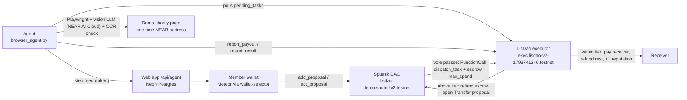

<h1 align="center">LisDao</h1>
<p align="center"><strong>Your DAO votes. An AI agent does the job in a real browser. A NEAR contract pays, within limits the DAO sets.</strong></p>
<p align="center">
  <a href="https://lisdao.vercel.app"><strong>Live app ↗</strong></a> · <a href="#try">Try it</a> · <a href="#proof">On-chain proof</a> · <a href="#quickstart">Run it</a> · <a href="#trust">Trust model</a> · <a href="#limits">Limitations</a>
</p>
<p align="center"><sub>NEAR TESTNET · SPUTNIK DAO v2 · RUST (near-sdk 5) · NEXT.JS 15 · PLAYWRIGHT · NEAR AI CLOUD · Built at NEAR HACKATHON</sub></p>

> **Testnet only.** No mainnet deployment and no real money. The "Water Project" charity is a demo page in this repo.

> **▶ Demo video (2 min):** https://lisdao.vercel.app/demo.mp4

## What it is
LisDao is an AI executor for **Sputnik DAO v2**. A DAO member writes a task in plain words ("Donate 0.1 NEAR to the water project"). The council votes in Sputnik. When the vote passes, the voted amount moves into escrow in the LisDao executor contract, an AI agent carries the task out in a real browser, and the **contract** (not the agent) pays, within spending limits enforced on-chain.

## The problem
Many real-world payees only accept crypto through a web page: a donation form that generates a fresh deposit address per donation, a checkout, a signup. A DAO can vote and hold funds, but it can't click through a website, so someone has to take the money off-chain and do it by hand. LisDao lets the DAO hand that web work to an AI agent **without handing it the keys**: the agent never holds the treasury, can't vote, and can only trigger a payout the contract allows.

<a id="try"></a>
## Try it (do X, see Y)
Live app: **https://lisdao.vercel.app** · demo DAO: **`lisdao-demo.sputnikv2.testnet`** · executor: **`exec.lisdao-v2-1793741346.testnet`**

| Do | See |
|---|---|
| Open the live app, scroll to **Limits** | A **Spending limits** panel read live from the executor contract (`get_config`): auto-approve tier start / step / max, the only agent account allowed to report, who can dispatch, task count |
| Click **Try the demo** | The demo DAO's proposals, read live from Sputnik (`get_proposals`) and the executor (`get_tasks`) |
| Open proposal **#11** ("Donate 0.1 NEAR to the Water Project") | Status `Passed · Executed`, a **Policy check: Within limit** box, the proposer's current tier, the on-chain agent report with the one-time address, and an **Audit trail** link to the executor's transactions |
| Click **View Agent Execution** | The **Live browser** panel: the agent's screenshots and each highlighted step it took |
| Open the payout tx for #11: [6rt1nGof…](https://testnet.nearblocks.io/txns/6rt1nGofX9Hb2zBxnWSb6V3vuKPpAm1w64N5NzQ2GvkQ) | `report_payout` by the agent account to the executor; the 0.1 NEAR transfer to the deposit address is a receipt inside it |
| (Wallet needed) Connect a testnet wallet, **Create New Proposal**, vote Yes as a council member | A new task is dispatched; the agent (when the operator's agent is online) runs it in the Live browser view. Proposing costs a 0.01 NEAR bond; only council members' votes count |
| (No wallet) `cd executor && cargo test` | 4 contract tests pass, including `over_cap` (payout above the voted cap panics `over spending cap`) and `not_agent` |
| (No wallet) `cd web && npm test` | Web unit tests pass, including a check that `web/app/page.js` is the full wallet / demo / limits app, not a placeholder shell |

## How it works

1. A member creates a Sputnik `FunctionCall` proposal that calls `dispatch_task` on the executor (0.01 NEAR bond, signed in their wallet).
2. The council votes. When it passes, Sputnik calls the executor and attaches `max_spend` as escrow; the rest of the treasury stays in Sputnik.
3. The agent (`agent/browser_agent.py`) polls `pending_tasks`, drives a locked-down Playwright browser, sends screenshots to a vision LLM on **NEAR AI Cloud**, and reads the one-time deposit address.
4. The agent calls `report_payout`. The **contract** decides: pay now (within the proposer's tier), escalate to a new Sputnik Transfer vote (above the tier), or refuse (above the voted cap).

## NEAR's role, concretely
- **Sputnik DAO v2** holds the treasury, the council and the votes. LisDao adds no voting of its own; it plugs in as the receiver of a `FunctionCall` proposal.
- **Executor contract** (`executor/src/lib.rs`, Rust, near-sdk 5) enforces the spending limits:

| Rule | Enforced in |
|---|---|
| Payout must be > 0, ≤ the voted `max_spend`, ≤ the task's escrow; otherwise the call panics `over spending cap` and nothing moves | `report_payout` |
| Auto-approve tier = 0.2 NEAR + 0.1 NEAR per finished task of the proposer, max 1 NEAR (live values in the app's Spending limits panel) | `auto_cap_of` |
| Within tier → pay receiver, return the rest of the escrow to the DAO, proposer +1 reputation | `report_payout` |
| Above tier → escrow back to the DAO, executor opens a Sputnik `Transfer` proposal for the council | `report_payout` |
| Only the configured agent can report; only `*.sputnikv2.testnet` DAOs can dispatch; a task settles once | `report_payout`, `report_result`, `dispatch_task` |
| Failure → status `Failed`, escrow back to the DAO | `report_result` |

- **NEAR AI Cloud** (`https://cloud-api.near.ai/v1`, OpenAI-compatible) runs the agent's vision model in the live demo (`x-ai/grok-4.7`). It chooses every click from screenshots and transcribes the deposit address; the payee must exactly match the page's `#deposit-address` element, or nothing is paid.
- **Wallets:** NEAR wallet-selector (Meteor, MyNearWallet, HOT, Here, Intear, Sender, Bitte, Near Mobile). Only Meteor has been tested end to end with a real transaction.

<a id="proof"></a>
## On-chain proof (NEAR testnet)
| What | Transaction |
|---|---|
| DAO | [lisdao-demo.sputnikv2.testnet](https://testnet.nearblocks.io/address/lisdao-demo.sputnikv2.testnet) |
| Executor | [exec.lisdao-v2-1793741346.testnet](https://testnet.nearblocks.io/address/exec.lisdao-v2-1793741346.testnet) |
| Proposal #5 created | [2RFPFNEW…](https://testnet.nearblocks.io/txns/2RFPFNEWBn9J7Lya8tLfdxGTWcG9SjYbMNwyiBBHtWJF) |
| Proposal #5 approved by council (VoteApprove → dispatches task 4; payout tx not recorded) | [C4gPFrU9…](https://testnet.nearblocks.io/txns/C4gPFrU9xjECcydmC61TY4vN99Y6dqKxdKN9omMniPL6) |
| Proposal #6 created | [2h7V8Jk5…](https://testnet.nearblocks.io/txns/2h7V8Jk51PhX9Br7Z14iM6zekUEAmE5opCrE3M8HZLeK) |
| Proposal #6 payout: agent calls `report_payout`, contract sends 0.1 NEAR to a one-time demo-charity address | [ogdnYy2S…](https://testnet.nearblocks.io/txns/ogdnYy2Sv8c1zq9NYXiiEuJWj6d3cmuoQvtZxaBnTuF) |
| Proposal #7 payout: agent calls `report_payout`, contract sends 0.1 NEAR to a one-time demo-charity address | [78pmYEL4…](https://testnet.nearblocks.io/txns/78pmYEL4PWZVuVnBNhkZsQAuAUKHZbGV1eK4qgUHJ5yu) |
| Proposal #9 created (live agent on NEAR AI Cloud, `x-ai/grok-4.7`) | [BLWit74i…](https://testnet.nearblocks.io/txns/BLWit74iq8u1BUJ4QMdHacmt73hZeyc9rzWAGHxaQJYd) |
| Proposal #9 approved by council (VoteApprove → dispatches task) | [2X3LdXx4…](https://testnet.nearblocks.io/txns/2X3LdXx4xd8U85g3AsrTtGTXRCXdC8Zfy7fmZydbcEi2) |
| Proposal #9 payout: NEAR AI agent calls `report_payout`, contract sends 0.1 NEAR (~3 min end to end) | [BFijitUn…](https://testnet.nearblocks.io/txns/BFijitUnuteeT7KP3VzhPt4eDMuQkKk56msMtQppEMH4) |
| Proposal #11 payout (recorded for the demo video): agent calls `report_payout`, contract sends 0.1 NEAR to a one-time demo-charity address | [6rt1nGof…](https://testnet.nearblocks.io/txns/6rt1nGofX9Hb2zBxnWSb6V3vuKPpAm1w64N5NzQ2GvkQ) |
| Access control (deliberate negative test): `report_payout` from non-agent test account `lisdao-voter-1793741346.testnet` → fails `only agent`, nothing moves | [5FA31kak…](https://testnet.nearblocks.io/txns/5FA31kakYN3PPqSk6q3A3cPdwe6QXiDoqeumX5wF2X3u) |
| Earlier: task dispatch + 0.1 NEAR payout | [68niAobb…](https://testnet.nearblocks.io/txns/68niAobbxYkYjhdRdPVU6m2AXsaGH5REbXJfSCHkrdSj), [31bQmyYa…](https://testnet.nearblocks.io/txns/31bQmyYaWd6XfvAkHoY2ey2BQzv9H7rqwA359YGPvhHb) |
| Earlier: 0.5 NEAR above tier → escalated | [6nEvYNDs…](https://testnet.nearblocks.io/txns/6nEvYNDs8FBcFn4TZi9YcXBxWbPAua9Zc3bZF65VzQNr) |

<a id="trust"></a>
## Trust model (honest)
- **Today: one operator.** A single agent account and key, run by the project's operator. You trust the operator's agent for **which address** it reports; the contract limits **how much** it can pay and **when** a payout needs a new vote.
- **On-chain guarantees:** the agent can't vote, can't touch the treasury beyond the escrowed `max_spend`, can't pay more than the voted cap, and can't auto-pay above the proposer's tier.
- **Off-chain checks** (reduce, don't remove, operator/LLM risk): payee read only from `#deposit-address` with an exact-match LLM read (up to 2 re-reads), browser locked to the charity origin, page content treated as untrusted in the prompt. See [docs/SECURITY.md](docs/SECURITY.md).
- **No TEE or attestation** is used today, and LisDao makes no private-inference claim for this deployment.
- **Future:** multiple independent agents with stake/slashing, TEE-attested agent runs, binding the payee to the vote (see [docs/ROADMAP.md](docs/ROADMAP.md)).

## Tracks fit
- **Social:** a community decides together, in a Sputnik DAO, what real-world task gets done and paid.
- **Security:** "give an AI money without the keys": escrow, a per-payout cap from the vote, reputation-based auto-approve tiers and escalation, all enforced by the contract and shown live in the UI with a per-proposal policy check.
- **Privacy / NEAR AI:** the agent's inference runs on NEAR AI Cloud. (No TEE/private-inference claim is made for this deployment.)
- **Agents / open:** an AI agent doing real web work with on-chain consequences; MIT licensed, runnable locally.

## Built during the hackathon
- The hackathon was announced on 2026-10-19. This project was built entirely after that: the repo's first commit is dated 2026-11-03, and all work is in this repo's public git history.
- Built in that window: the executor contract (escrow, voted cap, reputation tiers, escalation to a Sputnik Transfer vote), the Sputnik DAO v2 integration, the browser agent on NEAR AI Cloud with exact-match payee checks, the Live browser view and agent overlay, wallet-selector with several NEAR wallets, the live Spending limits panel and per-proposal policy check, and CI (contract tests, web tests, build).
- `legacy/contract/` is an earlier all-in-one prototype from the first commit; it is not used.

## Quickstart
```bash
# 1. Contract tests (4 tests: happy path + tiers/escalation, and 3 negative tests)
(cd executor && cargo test)

# Build & deploy to testnet (build checked with cargo-near 0.22 + near-cli-rs 0.30; deploy/init not re-run, they spend testnet NEAR)
cd executor
cargo near build non-reproducible-wasm   # wasm lands in target/near/lisdao_executor.wasm
near deploy <your-exec>.testnet target/near/lisdao_executor.wasm
# The executor pays the 0.01 NEAR `bond` itself when it escalates, so keep it funded,
# and the DAO policy must let the executor account add proposals.
near call <your-exec>.testnet new '{"owner":"you.testnet","agent":"agent.testnet","factory":"sputnikv2.testnet","base_cap":"200000000000000000000000","rep_step":"100000000000000000000000","max_auto":"1000000000000000000000000","bond":"10000000000000000000000"}' --accountId you.testnet
cd ..

# 2. Web (local: DATABASE_URL optional, in-memory store. Hosted on Vercel: set DATABASE_URL (Neon), the in-memory store does not persist there. Set AGENT_FEED_TOKEN or feed posts are refused)
(cd web && npm ci && cp ../.env.example .env.local && npm run dev)

# 3. Agent (config is read from ~/.lisdao/agent.env; needs the `near` CLI with the agent account's key)
cd agent && npm ci && pip install playwright && playwright install chromium
mkdir -p ~/.lisdao && cp ../.env.example ~/.lisdao/agent.env   # then fill in values
AGENT_PYTHON=$(which python3) ./run-agent.sh; cd ..   # any OpenAI-compatible vision endpoint; the live demo uses NEAR AI Cloud (below)
# NEAR AI Cloud as the agent's model: set LLM_PROVIDER=nearai and NEARAI_API_KEY (NEARAI_MODEL defaults to x-ai/grok-4.7, recommended for live runs; z-ai/glm-5.3-flash is cheaper but misread one character of the deposit address in a live run, which the exact-match check refused).
# If the LLM's address read doesn't exactly match #deposit-address, the agent asks it to re-read up to 2 more times; it never pays the DOM value unless the LLM's read equals it exactly.
# Dry run (browser + LLM + #deposit-address check, no feed posts, no on-chain calls):
#   LLM_PROVIDER=nearai NEARAI_API_KEY=... CHARITY_URL=https://lisdao.vercel.app/demo-charity python3 agent/browser_agent.py --dry-run
# Record the agent's browser (1280x800 video + one PNG per highlighted step, DRY_RUN only, no money moves):
#   WEB_URL=http://localhost:3000 scripts/record-run.sh      # -> /workspace/recordings/lisdao-run-*.webm
# OCR: tesseract.js downloads eng.traineddata on first run and caches it in agent/.
# To fetch it ahead of time (from repo root): ./agent/fetch-ocr-data.sh

# 4. Tests: web unit tests (rate limiter, spending-policy check, root-page integrity) and UI checks (Playwright, mocked wallet via ?e2e=1)
(cd web && npm test)   # root-page integrity fails if Copilot/another edit replaces web/app/page.js with a placeholder shell
pip install playwright && playwright install chromium
python web/e2e-buttons.py http://localhost:3000/   # from repo root, against a running web app
```

## Repo map
| Path | What |
|---|---|
| `executor/` | Rust executor contract (`dispatch_task`, `report_payout`, `report_result`, views) |
| `agent/` | `browser_agent.py` (Playwright + vision LLM: NEAR AI Cloud or any OpenAI-compatible endpoint; `--dry-run`), `ocr.js` (tesseract.js), `run-agent.sh` |
| `web/` | Next.js app; `lib/sputnik.js`, `/api/agent` feed, `/api/rpc` read-only RPC proxy, `/demo-charity` |
| `legacy/contract/` | Earlier prototype DAO contract (not used) |
| `docs/` | Architecture, security, demo script, testnet account list |
| `screenshots/` | Desktop and mobile screenshots |

<a id="limits"></a>
## Limitations
- Testnet only; not audited. Single agent account run by one operator; no TEE / attestation.
- The vote does not bind the receiver: `report_payout` pays the `receiver_id` the agent reports (up to `max_spend`). The address checks are off-chain.
- Any account under `.sputnikv2.testnet` can dispatch, and anyone can create one; there is no DAO allow-list. Reputation is per proposer across all DAOs, so it can be raised in a throwaway DAO.
- No timeout refund: only the agent settles a task; if it stops, the escrow waits in the executor. The owner (a single key) can swap the agent with `set_agent`.
- Payout transfers have no callback: if a transfer fails, the task still reads `Executed` and the amount returns to the executor, not the DAO.
- The policy check in the UI uses the proposer's **current** tier; the contract used the tier at payout time. The on-chain status (`Executed` / `Escalated` / `Failed`) is authoritative.
- Agent tasks are tuned for the demo charity flow, not arbitrary websites.

## Docs
[Architecture](docs/ARCHITECTURE.md) · [Security + limit test](docs/SECURITY.md) · [Roadmap](docs/ROADMAP.md) · [Demo script](docs/DEMO.md)

## License
MIT, see [LICENSE](LICENSE). Built at NEAR HACKATHON with help from AI coding tools.
